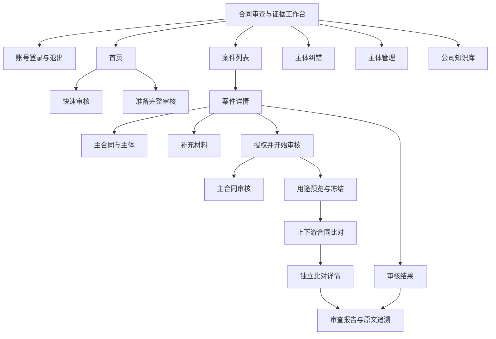
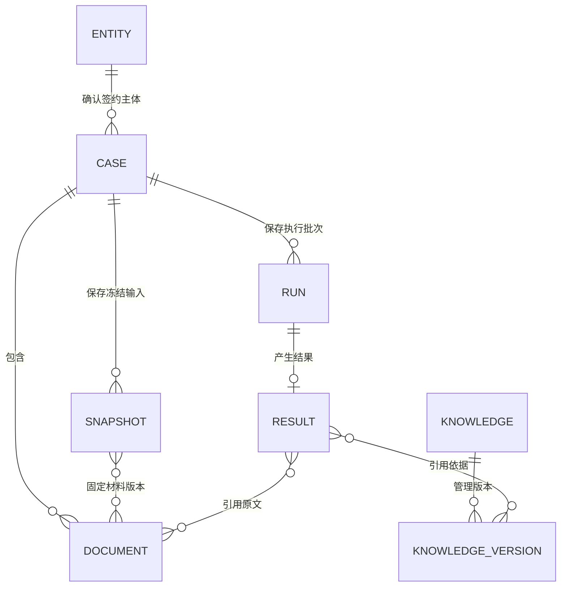
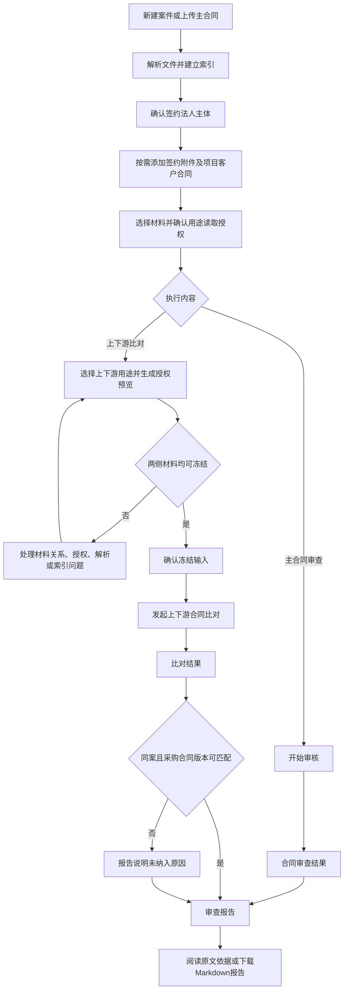
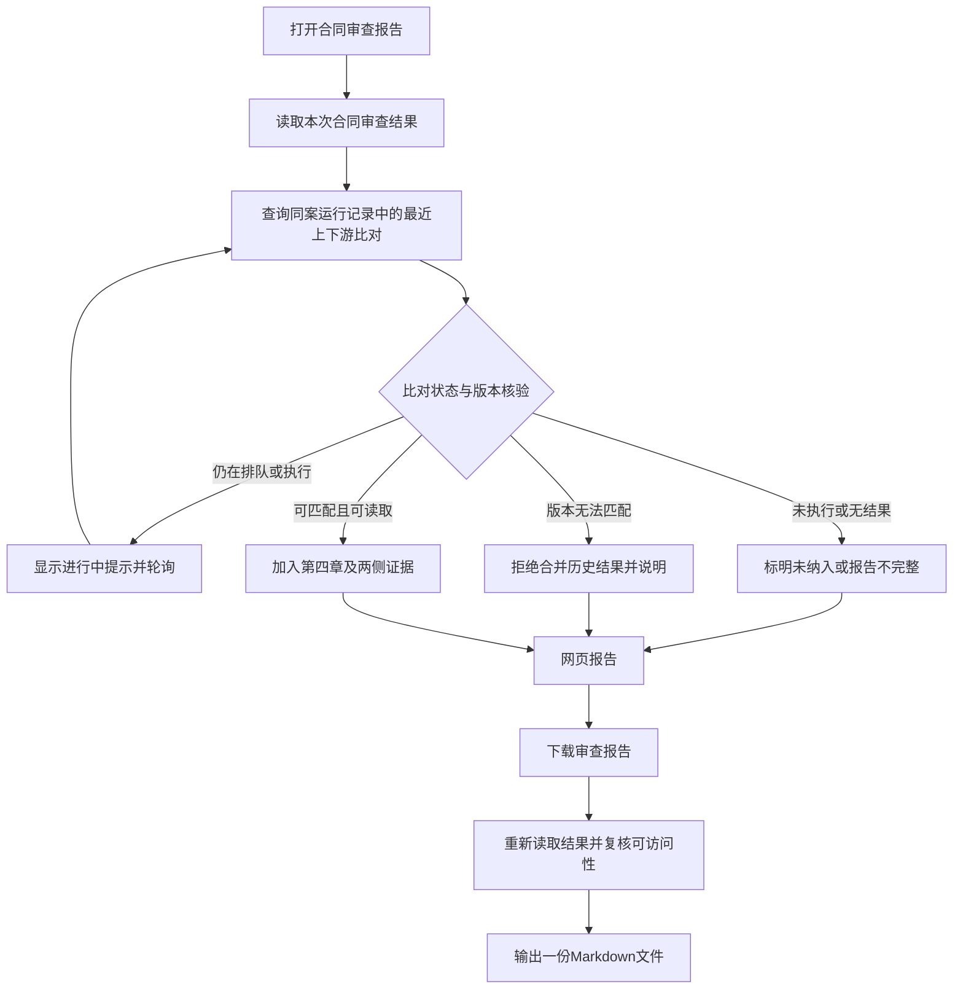
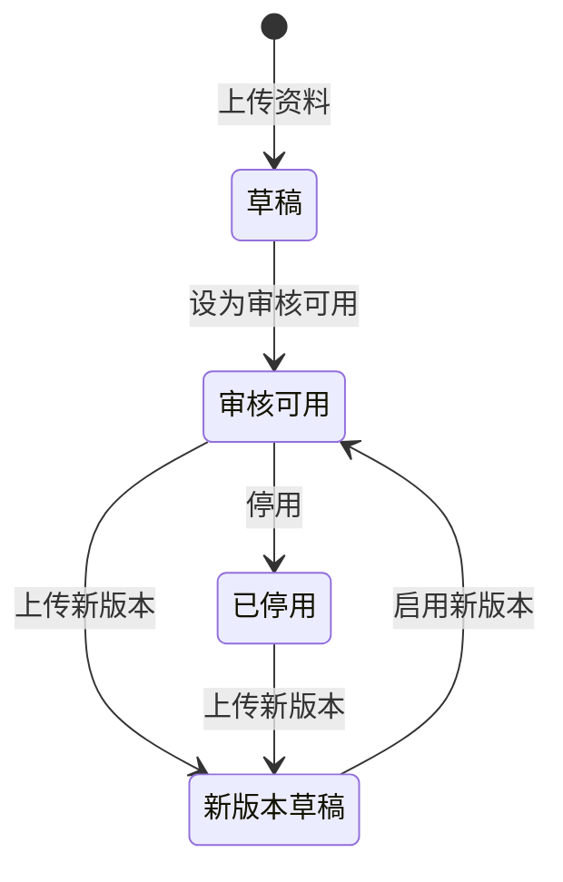
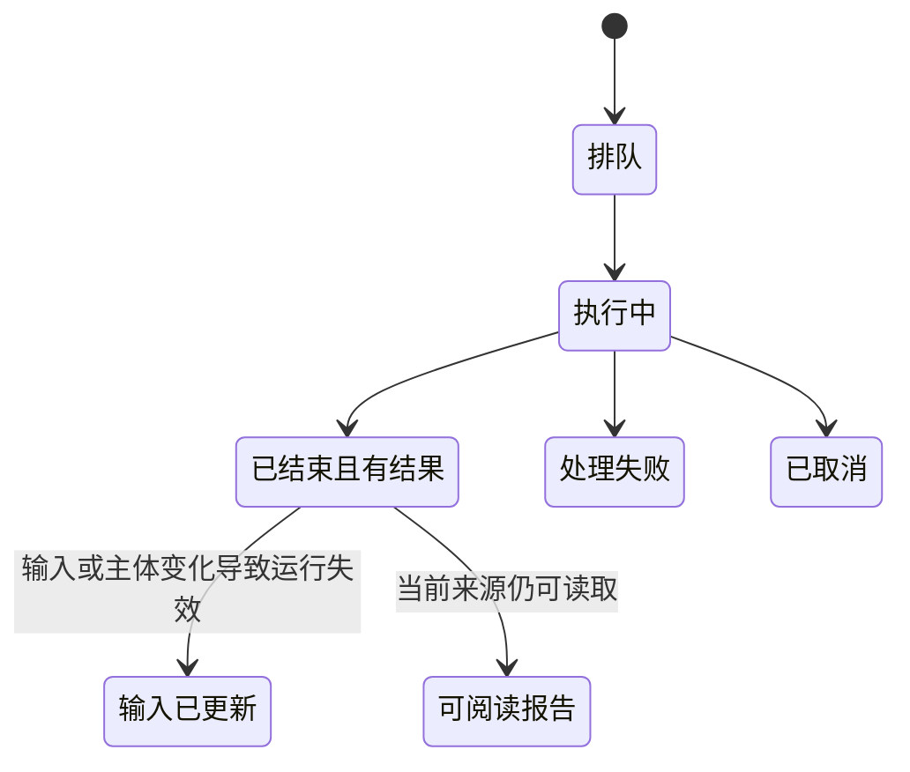

# 合同审查与证据工作台产品说明

> 文档日期：2026-10-22 
> 版本口径：以当前本地 `web/src` 中实际开放的页面、菜单及条件显示操作为准。 
> 本文描述已实现行为，不是未来功能规划。本文中的图使用 Mermaid；需在支持 Mermaid 的 Markdown 阅读器中查看。

## 1. 产品定位

系统以案件为工作单元，将待审合同、签约主体、签约附件、项目客户合同及审核记录集中管理。用户完成材料准备后，可发起合同审查、上下游合同比对，阅读带原文依据的结果，并下载汇总报告。

产品主要解决三个问题：

1. 主合同自身有哪些需要完善或核实的约定，相关法律及公司制度依据是什么。
2. 项目客户合同的要求，是否在采购合同中得到对应承接。
3. 结果引用了哪份文件、哪个版本和哪段原文，是否存在材料或检索限制。

审查结果是辅助判断的信息，页面保留适用性、候选状态、原文证据及待核实事项；机器结果不等于自动审批通过。

## 2. 功能架构与导航

左侧菜单依次为：首页、案件列表、主体纠错、主体管理、公司知识库。页头展示当前账号、所属组织和退出登录按钮。

本文不展开未开放菜单和原型页面。材料选择、读取授权、冻结及操作记录仍属于当前可见页面，纳入说明。

## 3. 核心业务对象

| 对象     | 产品含义               | 主要关系                |
| ------ | ------------------ | ------------------- |
| 案件     | 一次合同审查工作的档案容器      | 关联主体、材料、运行记录        |
| 法人主体   | 本案签约主体及材料范围边界      | 从主体台账选择并确认          |
| 待审主合同  | 本案核心审查文件           | 上下游比对中作为采购合同一侧      |
| 签约附件   | 对履约、交付等作补充约定的材料    | 属于本案材料范围            |
| 项目客户合同 | 同项目的上游要求来源         | 与本案采购合同配对比对         |
| 材料读取授权 | 允许当前用户按指定用途读取文本或金额 | 与上传、选择及冻结分开         |
| 来源预览   | 服务端核验后的当前用途材料清单    | 有效期内可用于冻结           |
| 冻结快照   | 一次执行所依据的不可变材料集合    | 记录用途、版本和清单哈希        |
| 审核运行   | 一次合同审查或上下游比对批次     | 具有独立状态和结果           |
| 知识资料   | 法律法规全文或公司制度文件      | 已启用版本可作为审核依据        |
| 审查报告   | 合同审查结果及可匹配的上下游比对章节 | 支持网页阅读和 Markdown 下载 |

此图是产品对象关系示意，不代表数据库字段或物理表结构。

## 4. 账号与访问

### 4.1 登录、会话与退出

用户使用系统账号和密码登录；密码支持显示或隐藏。账号和初始密码由管理员提供，当前登录页没有自助注册入口。若账号被要求首次修改密码，系统先进入修改密码页面；完成后进入工作台。退出登录后返回登录入口，会话失效时需要重新登录。

### 4.2 当前访问规则

导航菜单当前不按角色隐藏各业务模块，但这不代表全部账号都已拥有全部数据访问能力。后端仍执行案件与材料访问检查；主体及知识库的新增、编辑等按钮也会根据当前账号能力条件显示。不能把“入口可见”理解为“所有操作都可执行”。

## 5. 首页与案件列表

首页提供两种起点：

| 入口     | 使用场景       | 用户操作                   |
| ------ | ---------- | ---------------------- |
| 快速审核   | 先检查一份主合同   | 点击上传主合同，创建案件并进入准备及审核流程 |
| 准备完整审核 | 需要附件或上下游比对 | 创建案件后，整理主体、附件和项目客户合同   |

“快速审核”不表示材料上传即审核成功，仍需处理解析、主体、授权等准备条件及失败提示。

案件列表支持案件名称搜索、分页、调整每页数量；展示案件名称、签约主体、案件编号、状态、版本及创建时间。用户可以新建案件、上传合同审核、点击已有案件继续工作。当前前端没有批量清空案件的常规操作入口。

## 6. 案件详情与完整业务流程

案件详情包含四个步骤入口：主合同与主体、补充材料、授权并开始审核、审核结果。用户可以返回前一步查看和处理材料，步骤导航本身不代表审核已通过。

**当前两个执行入口仍分别存在。**结果汇总到同一份审查报告，不等于用户点击一次就会自动顺序执行两个任务。

## 7. 主合同、主体与补充材料

### 7.1 主合同与主体

先上传待审主合同，再从主体台账中选择法人主体并填写核对依据。确认后，主体成为案件范围边界。页面也可展开案件档案，查看案件编号、主体标识和版本。

主合同区域显示文件及解析、索引等准备状态。主体识别与台账维护是不同操作：上传合同不会自动完成法律主体确认。

### 7.2 材料类型与上传

| 类型      | 用途         | 准备规则             |
| ------- | ---------- | ---------------- |
| 待审主合同   | 核心审查对象     | 从主合同入口上传         |
| 签约附件    | 补充履约和交付等要求 | 主体确认后开放          |
| 同项目客户合同 | 上下游比对的上游材料 | 主体确认后开放，并确认同项目关系 |

案件材料支持 PDF、DOCX，单个最大 30 MiB。上传后服务端进行解析并排队建立索引；材料列表展示用途、文件大小、解析进度、索引状态及版本。系统按用户指定的材料类型及关系组织输入，不应依靠文件名称自动判断上下游身份。

### 7.3 上传、解析、索引、授权、冻结的区别

这张图表示审核输入的准备依赖；实际索引处理和用户授权可以在不同时间发生。上传成功不等于解析完成，解析完成不等于索引就绪，已上传文件也不会自动全部进入本次冻结清单。

### 7.4 移除与撤销

材料列表提供移除操作，确认弹窗说明其影响。移除会撤销相应材料选择与授权，并使受影响的进行中运行失效。撤销读取授权也会影响材料及既有结果的可访问性。历史快照不是绕过当前读取检查的通行证。

## 8. 审核范围、读取授权与冻结

### 8.1 读取授权

“审核范围与读取授权”中可以核对材料关系和用途，并授权读取文本、选择是否允许读取金额、设置有效期。材料用途包括合同审查和上下游比对，两种用途不能相互替代。涉及金额的输入要求相应金额授权。

页面会提示授权对象、范围和有效期；授权失败、到期、范围冲突或撤销时需要重新核对。展开“操作记录：主体确认与材料授权”可查看主体确认、更正和授权记录。

### 8.2 用途预览与冻结

“高级输入设置：用途预览与冻结”用于检查本次材料集合：

- 合同审查材料：核验本案选择的主合同及相应签约附件。
- 上下游比对准备：核验待审主合同与已确认同项目关系、具备上下游用途授权的项目客户合同。

点击“生成授权预览”后，逐份展示来源与是否可冻结。预览由服务端核验，页面标明 10 分钟有效期。确认冻结时还会再次复核案件版本、授权、文件哈希及索引；输入变化或预览过期时需要重新生成预览。

上下游比对必须至少有主合同与项目客户合同两侧材料，且双方均通过检查。不能只冻结可用的一侧来完成双合同比对。

冻结完成后页面展示快照编号、案件版本、纳入材料数、用途和输入清单哈希。冻结只保存输入，不会自动启动全部审核流程；上下游用途下另有“发起上下游合同比对”按钮。

## 9. 合同审查

用户在“发起主合同审核”区域查看文件、解析进度、原文定位、主体和读取授权状态，准备就绪后点击“开始审核”。页面提供刷新状态、管理背景与材料等操作，并展示审核执行历史。

审核内容包括：理解合同内容与审查主题、检索本地法规和联网法律资料、检索已启用公司制度文件、形成适用性分析、问题说明、处理建议与原文依据。

审核报告按以下结构阅读：

1. 合同概况与审查范围：合同理解、审查摘要、主题。
2. 法律合规审查：法律相关发现、适用性、引用依据及建议。
3. 公司制度审查：公司制度相关发现、原文依据及建议。
4. 上下游合同比对：符合合并规则的比对结果或明确的缺失状态说明。

每项发现可能包含合同原文、法律或制度依据、适用条件、未确定事实、建议处理及覆盖限制。检索过程可以展开，查看检索渠道、关键词、时间及命中情况。

历史批次若采用旧版付款与价款定位流程，详情仍可能展示价款口径、付款阶段、事实候选、引用证据和事实确认操作；不能把旧流程记录解释为新版全合同审查已完成。确认事实形成快照后，可按确认事实重新运行；历史结果不会被直接改写。

## 10. 上下游合同比对

### 10.1 对比方向

项目客户合同是上游要求，待审主合同在该功能中作为采购合同一侧。存在多份项目客户合同时，按“逐份项目客户合同 × 本案采购合同”形成合同组，不是把所有上传文件任意两两比较。

### 10.2 十四类比对内容

| 类别         | 关注内容            |
| ---------- | --------------- |
| 工作范围与交付物   | 两侧任务、范围及交付成果的承接 |
| 交付计划       | 时间节点、进度要求       |
| 验收与整改      | 验收标准、流程及整改责任    |
| 质量、服务与保障   | 质量要求和服务承诺       |
| 质保与缺陷处理    | 保修及缺陷处理安排       |
| 合规、资质与现场要求 | 履约资质和现场要求       |
| 数据、保密与安全   | 数据处理、保密及安全义务    |
| 知识产权与第三方权利 | 权属、许可及侵权责任      |
| 变更与项目配合    | 需求变更与项目协作       |
| 付款与商业条件    | 价款、付款及商业约定      |
| 违约责任与风险分配  | 违约责任及风险承担       |
| 分包与人员安排    | 分包约束与人员要求       |
| 暂停、解除与退出   | 中止、解除及退出义务      |
| 文件、报告与审计   | 文档提交、报告及审计配合    |

### 10.3 结果表达

覆盖结论包括已找到对应约定、部分对应、候选未覆盖、候选不一致、候选不适用。另有候选已形成、需要补充材料、暂无法判定、需要人工复核等状态。覆盖结论与处理状态是不同维度。

每个条目展示上游要求与下游约定两侧证据：文档版本、页码、引文及相关来源标识。未覆盖类证据还可能展示已检查页码、章节、检索词和解析覆盖情况；不能把“没有返回引文”直接当作“合同没有约定”。

当前处理按类别校验并保留有效条目；失败项记录原因，并进行一次修正重试。无法形成有效证据时，独立详情明确提示比对失败，不将重复空结果当作有效结论。运行结束和比对结论有效是两个概念。

## 11. 统一审查报告与下载

当前合并采用同案最近比对记录，并要求各合同组的采购合同版本能在本次审查结果的材料引用集合中匹配。无法匹配时提示，不继续挑选更旧的结果来填补。若最近比对仍在运行，报告章节定时刷新；无法读取结果时说明缺失原因。

**汇总报告是展示及导出层面的合并，不是生成一个新的联合模型判断。**审查结果和比对结果仍保留独立批次、输入快照和来源标识；不能把两份独立结论理解为模型已经自动综合消除了全部风险。

网页和下载文件均包含上下游章节；没有可合并结果时仍说明状态。下载前重新读取审查结果与比对数据，避免仅根据页面缓存生成报告。当前导出为 Markdown，合并文件有 4 MiB 大小上限；未提供正式 PDF 或 Word 导出入口。

当前报告章节在打开页面及下载时读取比对记录，不是另行持久化的一份联合报告快照；后续新增比对可能改变同一审查详情中汇入的批次，报告中保留批次标识以便辨认。

独立上下游比对详情及其 Markdown 下载仍可访问，用于单独复核。

## 12. 原文证据追溯

审查详情支持打开引用位置，在侧边区域查看引用前后文及解析文本，并在具备来源条件时查看原件或页码视图。读取时会复核来源及引用身份；无法读取或校验不通过时展示提示。

DOCX 的固定页码来自规范化 PDF 呈现，不能视作任意 Word 环境下都一致的页码。解析文本不保留原始版式，应结合页面视图核对上下文。原文哈希及位置核验证明的是引用绑定关系，不代表法律判断正确。

## 13. 主体管理与主体纠错

### 13.1 主体管理

主体台账支持搜索和分页。具备管理能力时可新增、编辑主体，维护法人主体名称、统一社会信用代码、主体核验依据及启用状态。核验依据必填，用于记录主体来源和确认理由。

### 13.2 主体纠错

主体纠错入口展示可处理案件，可搜索案件并进入纠正页面。用户选择更正后的主体、填写纠错依据，先查看更正影响，再确认操作。

主体更正不会将旧材料自动迁移到新主体，也不会改写历史快照或结果；原材料与审计记录保留为历史。该操作会影响已完成及未完成运行，确认前需要查看弹窗说明。

## 14. 公司知识库

公司知识库有“公司制度文件”和“法律法规全文”两个分类，支持查看资料名称、版本、原文段落数量、状态和原文内容。

具备管理能力时，可上传资料、上传新版本、设为审核可用或停用。上传支持 PDF、DOCX、TXT、MD，最大 10 MB；可维护资料名称、发布机构或公司、适用范围、生效和失效日期、原文链接。上传和启用是不同操作，草稿资料不能仅因已上传就认定审核已使用。

图中“新版本草稿”表示另一份版本记录，不表示覆盖改写原版本。页面还提供“添加法规全文与测试制度”的样例初始化操作，测试制度应由使用方自行识别其适用性，不应直接等同于本公司的正式制度。

审查中会按合同内容检索相关原文；结果展示资料来源、版本、适用时间和引用，资料现已停用时可展示相应提醒。

## 15. 状态、异常及恢复说明

| 页面现象         | 产品含义                   | 用户处理                   |
| ------------ | ---------------------- | ---------------------- |
| 上传失败         | 文件未成功进入案件              | 核对类型、大小和连接后重试          |
| 解析中或解析失败     | 正文尚未就绪                 | 查看进度或失败提示，处理后继续        |
| 索引未就绪或版本已过期  | 索引不能用于当前输入，提示可能合并多种原因  | 结合材料列表和服务处理状态核实        |
| 索引失败         | 任务已失败                  | 当前没有通用前端索引重试按钮，需要管理员处理 |
| 已上传数量大于可冻结数量 | 部分材料用途、关系、授权或准备状态不满足要求 | 逐份核对来源预览               |
| 预览失效或版本冲突    | 材料、案件或授权已变化            | 重新预览并冻结                |
| 已冻结但未开始      | 只保存输入快照                | 按对应入口启动任务              |
| 排队或执行中       | 任务尚未结束                 | 页面刷新或等待状态更新            |
| 比对失败         | 没有可核验的比对输出             | 查看具体限制，修正后重新发起         |
| 部分条目待核实      | 只有部分条目形成依据或结论          | 保留有效内容，核实未完成类别         |
| 结果不可访问       | 会话、来源访问或材料状态不满足要求      | 重新登录、核对授权或来源           |
| 报告未纳入上下游章节内容 | 尚未运行、仍在运行、读取失败或版本无法匹配  | 按报告中的具体提示处理            |

图表示用户可理解的主要状态转换，不穷举所有内部状态。即使运行状态已结束，仍需判断输出是否有可核验证据；“无有效结果”不是“无风险”。

## 16. 当前版本使用边界

- 业务输入来自本案上传资料；页面提示真实外部财务、合同系统尚未接入。
- 当前不存在“一键同时完成两种审核”的统一执行入口。
- 用户手动指定材料用途，并确认同项目关系；系统不会仅凭文件名完成可靠分类。
- 导出格式为 Markdown；Mermaid 图属于本文档说明图，不表示产品内有可编辑流程设计器。
- 材料读取授权与管理操作限制仍实际存在，不能宣称所有登录账号已能无条件读取全部资料。
- 失败提示中仍有聚合文案，不能只根据一句“索引未就绪或版本已过期”确定具体后台故障。
- 本文根据当前源代码核对形成；未将登录后的全部条件页面逐项实机验收，不将文档说明替代实际业务验收。

## 17. 建议的实际操作顺序

1. 登录系统，准备或核对签约主体台账及审核依据资料。
2. 创建案件，上传主合同，完成解析和主体确认。
3. 按需上传附件和同项目客户合同，确认材料关系。
4. 核对文本、金额及用途授权，处理未就绪材料。
5. 需要上下游比对时，先预览冻结双侧材料，再发起比对。
6. 发起主合同审查，按批次查看结果。
7. 打开审查报告，确认上下游章节是已纳入还是明确提示未完成。
8. 核查重要引文、适用性与待核实事项，再下载最终需要留存的 Markdown 文件。

## 18. 文档核对依据

文档依据当前可见功能相关实现核对：`App.tsx`、`LoginPage.tsx`、`ChangePasswordPage.tsx`、`CreateCaseDialog.tsx`、`CaseDetailPage.tsx`、`RunHistoryPanel.tsx`、`RunResultsPage.tsx`、`ResearchResults.tsx`、`ReportComparisonSection.tsx`、`UpstreamComparisonResultsPage.tsx`、`EntityManagementPage.tsx`、`EntityCorrectionPages.tsx`、`CompanyRulesPage.tsx`。
